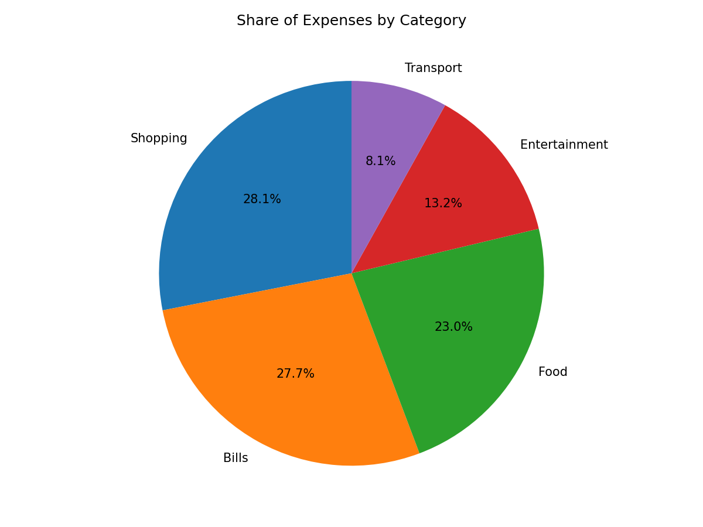
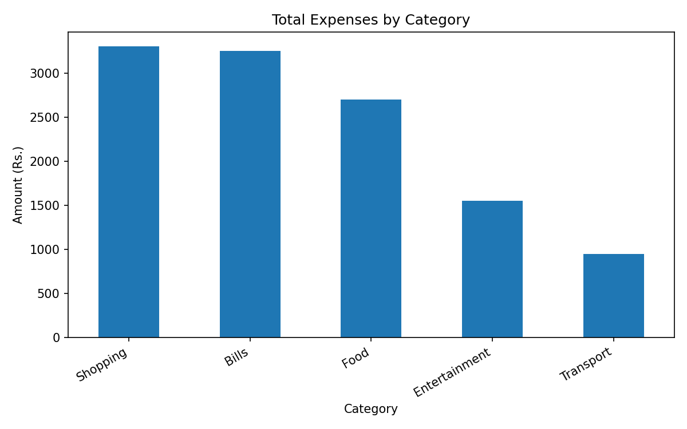
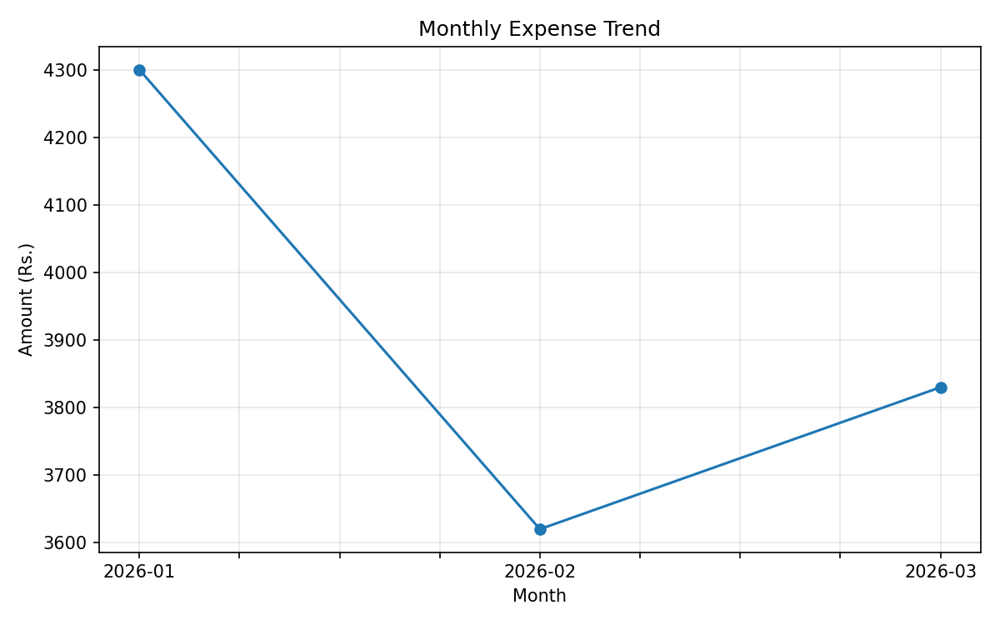

# Personal Expense Analysis 📊💰

[](https://www.python.org/)
[](https://pandas.pydata.org/)
[](https://numpy.org/)
[](https://matplotlib.org/)
[](https://www.cuchd.in/)

An end-to-end Python data analysis and visualization system designed to track, aggregate, and visualize personal expenditures across time, categories, and payment channels.

Developed as an academic project for **Master of Computer Applications (MCA) in Data Science**, **Chandigarh University (UIC)**.

---

## 📌 Project Overview

Managing personal finances is critical for budgeting and savings, yet daily micro-expenses often go untracked. This project implements a structured data pipeline:
1. **Data Ingestion & Pre-processing:** Ingests structured expense records (`expenses.csv`), converts ISO dates to `datetime64`, and derives chronological monthly grouping keys.
2. **Statistical Aggregation:** Employs NumPy and Pandas vector operations to determine total expenditures, average transaction values, daily burn rates, and group-level spending distributions.
3. **Exploratory Data Visualization:** Generates publication-ready Matplotlib charts illustrating category budget shares, comparative category expenditures, and monthly spending trends.

---

## 🏗️ Architecture & Data Processing Pipeline

```
┌─────────────────────────────────┐
│     Raw Input Layer (CSV)       │ ──► expenses.csv (Date, Category, Amount, Payment Method)
└─────────────────────────────────┘
                │
                ▼
┌─────────────────────────────────┐
│      Pre-processing Layer       │ ──► Pandas DataFrame, pd.to_datetime(), Date-time extraction
└─────────────────────────────────┘
                │
                ▼
┌─────────────────────────────────┐
│         Analysis Layer          │ ──► np.sum(), np.mean(), groupby('category'), groupby('month')
└─────────────────────────────────┘
                │
                ▼
┌─────────────────────────────────┐
│       Output & Visualization    │ ──► Console Summary Report & Matplotlib Visualizations
└─────────────────────────────────┘
```

---

## 📊 Visualizations

### 1. Share of Expenses by Category (Pie Chart)
Illustrates proportional expenditure allocation across categories (Shopping, Bills, Food, Entertainment, Transport).



### 2. Total Expenses by Category (Bar Chart)
Comparative visualization identifying primary cost drivers and spending concentration.



### 3. Monthly Expense Trend (Line Chart)
Chronological trajectory tracking expense escalation from January through March.



---

## 📁 Repository Structure

```
PersonalExpenseAnalysis/
│
├── expenses.csv             # Primary expense dataset (Date, Category, Amount, Payment Method)
├── main.py                  # Core Python processing, analytics, and chart generation script
├── requirements.txt         # Project package dependencies
├── README.md                # Comprehensive project documentation
├── sample_output.txt        # Verified console report execution log
│
├── category_pie_chart.png   # Proportional spending breakdown chart
├── category_bar_chart.png   # Category comparative bar chart
└── monthly_line_chart.png   # 3-Month longitudinal trend line chart
```

---

## 📋 Dataset Schema

| Column | Data Type | Description | Sample Values |
|---|---|---|---|
| `date` | `datetime64` / `string` | Transaction date (YYYY-MM-DD) | `2026-01-02`, `2026-02-10` |
| `category` | `string` / `object` | Functional expense classification | `Food`, `Transport`, `Shopping`, `Bills`, `Entertainment` |
| `amount` | `float64` / `int64` | Transaction value in Indian National Rupees (₹) | `250`, `850`, `600` |
| `payment_method` | `string` / `object` | Mode of settlement | `UPI`, `Card`, `Cash` |
| `month` *(derived)* | `string` / `period` | Extracted monthly aggregation bucket | `2026-01`, `2026-02`, `2026-03` |

---

## 🚀 Getting Started & Execution

### Prerequisites
- Python 3.10 or higher
- Git installed on your system

### Installation

1. **Clone the repository:**
   ```bash
   git clone https://github.com/jaryalsaksham/PersonalExpenseAnalysis.git
   cd PersonalExpenseAnalysis
   ```

2. **Set up a virtual environment (Optional but Recommended):**
   ```bash
   python -m venv venv
   # On Windows:
   venv\Scripts\activate
   # On macOS/Linux:
   source venv/bin/activate
   ```

3. **Install dependencies:**
   ```bash
   pip install -r requirements.txt
   ```

4. **Execute the analysis program:**
   ```bash
   python main.py
   ```

---

## 📈 Key Findings & Insights

* **Total Spending:** ₹11,750.00 across 28 logged transactions.
* **Top Spending Category:** **Shopping** accounts for the largest budget share (₹3,300.00), followed closely by **Bills** (₹3,250.00) and **Food** (₹2,700.00).
* **Primary Payment Channel:** **UPI** represents the dominant payment mechanism (₹6,280.00), followed by **Cards** (₹3,950.00) and **Cash** (₹1,520.00).
* **Average Daily Burn:** ₹419.64 per transaction day.

---

## 🎓 Academic Attributions

* **Student:** Saksham Jaryal (UID: `26MCD10073`)
* **Department:** University Institute of Computing (UIC), Chandigarh University
* **Degree:** Master of Computer Applications (MCA) in Data Science
* **Subject Code:** 26-CAH-606
* **Supervisor:** Ms. Prabhjot Kaur (Assistant Professor)
* **Session:** 2026 – 2028

---

## 📄 License
This repository is open-sourced under the MIT License for educational and research demonstration purposes.
